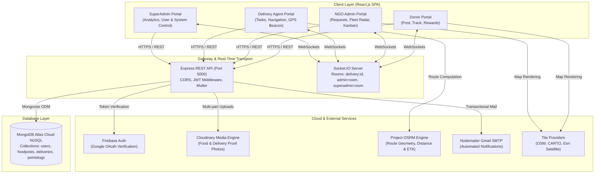
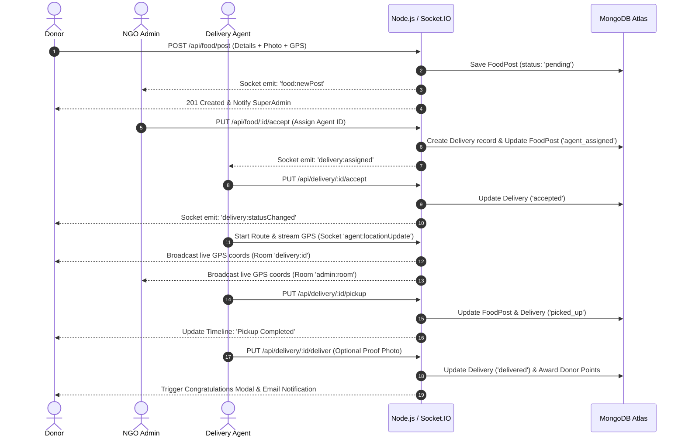
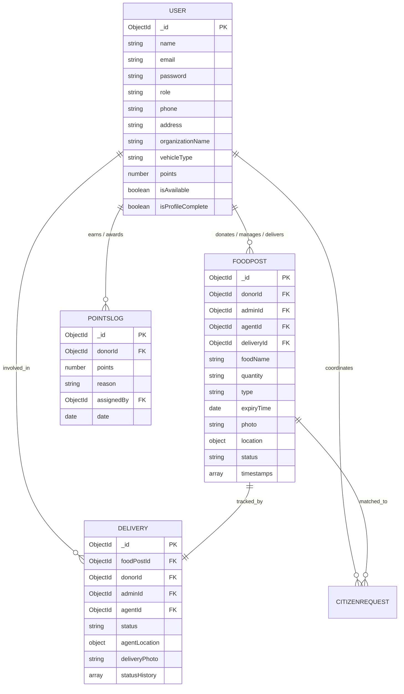

# 📋 Comprehensive Project Report: FeedForward

**Project Title:** FeedForward — Smart Real-Time Food Waste Redistribution & Volunteer Logistics Platform  
**Academic / Capstone Project Report**  
**Technology Stack:** MERN Stack (MongoDB, Express.js, React.js, Node.js) with WebSockets (Socket.IO), OSRM Routing, Leaflet Maps, Cloudinary, and Firebase Authentication  
**Repository:** [feedforward](file:///d:/FEEDFORWARD/feedforward)  

---

## Table of Contents
1. [Executive Summary](#1-executive-summary)
2. [Introduction & Problem Statement](#2-introduction--problem-statement)
3. [Project Objectives & Scope](#3-project-objectives--scope)
4. [System Architecture & Data Flow](#4-system-architecture--data-flow)
5. [Role-Based Access Control (RBAC) & Stakeholders](#5-role-based-access-control-rbac--stakeholders)
6. [Complete Database Schema & Data Dictionary](#6-complete-database-schema--data-dictionary)
7. [Detailed Module & Feature Breakdown](#7-detailed-module--feature-breakdown)
8. [Real-Time WebSocket & Mapping Engine](#8-real-time-websocket--mapping-engine)
9. [RESTful API Specification](#9-restful-api-specification)
10. [Frontend UI/UX Design System](#10-frontend-uiux-design-system)
11. [Security, Performance & Non-Functional Requirements](#11-security-performance--non-functional-requirements)
12. [Testing, Deployment & Verification](#12-testing-deployment--verification)
13. [Limitations & Future Enhancements](#13-limitations--future-enhancements)
14. [Conclusion](#14-conclusion)

---

## 1. Executive Summary

According to the United Nations Food and Agriculture Organization (FAO), roughly one-third of all food produced globally for human consumption is lost or wasted every year—amounting to approximately 1.3 billion tonnes. Concurrently, hundreds of millions of people face chronic food insecurity and malnutrition. The crux of this paradox does not lie in an aggregate lack of food, but rather in a severe **distribution and coordination bottleneck**. 

Restaurants, wedding halls, corporate cafeterias, and domestic donors regularly discard excess edible food because they lack an immediate, reliable, and hassle-free channel to donate it before it spoils. Conversely, hunger-relief non-governmental organizations (NGOs) operate with limited logistical visibility, decentralized volunteer groups, and insufficient real-time coordination. Furthermore, donors frequently experience "donation fatigue" due to a total lack of transparency regarding whether their contribution actually reached beneficiaries.

**FeedForward** is an end-to-end, production-grade Web application engineered to bridge this gap. Built upon the MERN stack (MongoDB, Express.js, React.js, Node.js), FeedForward establishes a synchronized four-tier digital ecosystem:
1. **Food Donors** submit donations with automated GPS geolocation, photo verification, and food metadata. Donors track the live journey of their donation through an interactive, multi-step tracker with live agent map navigation and earn gamified reward points.
2. **NGO Administrators** operate an operational command center to inspect incoming requests (targeted or city-wide broadcast), claim donations, dispatch verified delivery agents, and monitor active fleet positions on an interactive city radar map.
3. **Delivery Agents** (Couriers / Volunteers) manage accepted tasks, stream continuous GPS telematics via WebSockets, and utilize turn-by-turn OSRM routing from donor pickup to NGO drop-off.
4. **Super Administrators** govern platform operations, inspect platform-wide health metrics and Recharts analytics, manage all user profiles and roles, and override system anomalies with a real-time audit trail.

---

## 2. Introduction & Problem Statement

### 2.1 The Problem
Traditional charitable food donation is characterized by friction, manual intervention, and high communication overhead:
* **Perishability Constraints:** Cooked food has a short shelf-life (typically 4–6 hours). Any lag in donor-to-NGO handoff leads to bacterial spoilage.
* **Information Asymmetry:** NGOs cannot anticipate when and where surplus food will be generated; donors do not know which NGOs currently have capacity or storage.
* **Logistical Inefficiencies:** Without route optimization or live fleet tracking, volunteer agents waste critical time locating donors or reporting their transit status.
* **Lack of Accountability and Donor Retention:** Traditional donation drop-boxes or informal handoffs offer zero proof of delivery or donor engagement, discouraging recurring donations.

### 2.2 Proposed Solution
FeedForward solves these challenges through automation, geolocation, and real-time bi-directional telematics:
* **Frictionless Posting:** Donors can authenticate instantly via Google OAuth or local accounts, auto-detect their street address via browser GPS and reverse geocoding, and upload mandatory photographic proof stored on Cloudinary.
* **Intelligent Broadcast vs. Directed Dispatch:** Donors can target a specific registered NGO or issue an emergency **City Broadcast** that alerts all connected NGOs simultaneously via Socket.IO.
* **Live Fleet Tracking & Telematics:** Using Leaflet.js, OpenStreetMap, and Socket.IO, delivery agents stream their live coordinates (`navigator.geolocation.watchPosition`) to both the donor and the NGO admin, calculating real-time distance and Estimated Time of Arrival (ETA).
* **Gamification & Social Incentives:** Donors earn tiered points (`Seed` 🌱, `Sprout` 🌿, `Green Hero` 🌳, `Champion` 🏆, `Legend` ⭐) with automated recognition badges and point logs.

---

## 3. Project Objectives & Scope

### 3.1 Primary Engineering Objectives
1. **Zero-Latency State Synchronization:** Establish bi-directional WebSocket communication between delivery couriers, donors, and administrators for sub-second status and location updates.
2. **Robust Multi-Role Access Control:** Enforce secure Role-Based Access Control (RBAC) across four distinct roles (`donor`, `admin`, `agent`, `superadmin`) using signed JSON Web Tokens (JWT) and Bcrypt hashing.
3. **Interactive Cartographic Integration:** Implement browser-based maps supporting street, detailed city, and satellite tile layers, dynamic turn-by-turn routing via the OSRM engine, and live moving markers.
4. **Resilient Asynchronous Services:** Offload heavy media processing (Cloudinary) and transactional email dispatches (Nodemailer Gmail SMTP) to non-blocking asynchronous event loops.
5. **Enforced Profile Completion Workflow:** Implement an onboarding safeguard ensuring every user completes their profile (contact, address, pincode, organization details, or vehicle type) prior to accessing core system dashboards.

### 3.2 Scope of the Application
The platform addresses urban and semi-urban food redistribution networks, facilitating coordination between commercial/domestic donors, registered charities, and decentralized volunteer couriers.

---

## 4. System Architecture & Data Flow

FeedForward follows a decoupled **Client-Server Architecture** adhering to RESTful API principles for transactional operations and persistent WebSocket connections for real-time telematics.

### 4.1 High-Level Architecture Diagram



### 4.2 End-to-End Donation Lifecycle Flow



---

## 5. Role-Based Access Control (RBAC) & Stakeholders

The platform enforces strict role isolation. Access rights are validated at both the client routing level (`Protected` routes in `App.js`) and the server endpoint level (`protect` and `requireRole` middleware).

| Role | Onboarding Method | Primary Responsibilities & Permitted Actions |
| :--- | :--- | :--- |
| **Citizen / Beneficiary** | Direct Public Access (No Login Required) | • Submit immediate food assistance request with portion needs & location.<br/>• Auto-generates secure 4-digit pickup/verification PIN.<br/>• Track request review status using mobile phone number.<br/>• Browse available local surplus food before requesting. |
| **Donor** | Public Registration or Google 1-Click OAuth | • Upload surplus food posts with photos and GPS.<br/>• Choose target NGO or broadcast city-wide.<br/>• Track live donation progress via 6-step timeline.<br/>• View agent real-time moving location on map.<br/>• View reward points and unlock badges (`Seed` to `Legend`). |
| **NGO Admin** | Superadmin-Provisioned (Restricted to verified organizations) | • Review incoming targeted and broadcast food requests.<br/>• Claim broadcast posts on behalf of the NGO.<br/>• Accept requests and assign active, verified delivery agents.<br/>• Fleet Radar: Monitor all connected agents on live map.<br/>• Kanban and list views of active deliveries.<br/>• Award bonus points to donors for large contributions. |
| **Delivery Agent** | Superadmin-Provisioned (Restricted to verified fleet) | • Receive incoming pickup and drop-off assignments.<br/>• Accept or reject delivery tasks (auto-reassigns on reject).<br/>• Turn-by-turn map navigation from current position to donor and drop-off.<br/>• Stream live background GPS coordinates via WebSockets.<br/>• Update delivery milestones (`accepted` → `in_transit` → `picked_up` → `delivered`).<br/>• Upload photographic proof of delivery. |
| **Super Administrator** | Pre-seeded root administrator (`seedSuperadmin.js`) | • Global system telemetry and health metrics dashboard.<br/>• Interactive Recharts visualization (Posts, Users, Deliveries).<br/>• User & Fleet Governance: Create, edit, toggle availability, and delete users.<br/>• Global Food Oversight: Force-override status or delete any post.<br/>• Live platform-wide activity feed and audit logs. |

---

## 6. Complete Database Schema & Data Dictionary

The persistence tier is built on MongoDB Atlas using Mongoose ODM, composed of four highly coupled schemas:

### 6.1 `User` Schema
Stores identity credentials, contact details, authentication profiles, and role-specific configurations.

| Field Name | Type | Constraints / Defaults | Description |
| :--- | :--- | :--- | :--- |
| `_id` | ObjectId | Primary Key (Auto) | Unique system identifier |
| `name` | String | Required, Trimmed | Full name of the user or representative |
| `email` | String | Required, Unique, Lowercase | Unique login email address |
| `password` | String | Minlength: 6, Optional for OAuth | Bcrypt-hashed password string (12 salt rounds) |
| `phone` | String | Trimmed | Contact mobile number |
| `role` | String | Enum: `['donor', 'admin', 'agent', 'superadmin']` | Core access control role |
| `profilePhoto`| String | Default: `""` | Cloudinary CDN URL for user avatar |
| `address` | String | Default: `""` | Primary street address |
| `city` | String | Default: `""` | City of operation |
| `pincode` | String | Default: `""` | Postal code |
| `bio` | String | Default: `""` | Brief user or organization biography |
| `organizationName` | String | Default: `""` | Official NGO name (Admin role) |
| `donorType` | String | Default: `""` | Category: `Individual`, `Restaurant`, `Caterer`, `Bakery` |
| `points` | Number | Default: `0` | Cumulative gamified reward points |
| `vehicleType` | String | Default: `""` | Mode of transport: `Bike`, `Scooter`, `Car`, `Van`, `Walking` |
| `isAvailable` | Boolean | Default: `true` | Fleet availability status for delivery agents |
| `isProfileComplete` | Boolean | Default: `false` | Onboarding completion flag (Enforces address/phone entry) |
| `createdAt` | Date | Default: `Date.now` | Account creation timestamp |

### 6.2 `FoodPost` Schema
Represents a specific surplus food donation lifecycle.

| Field Name | Type | Constraints / Defaults | Description |
| :--- | :--- | :--- | :--- |
| `_id` | ObjectId | Primary Key (Auto) | Unique post identifier |
| `donorId` | ObjectId | Ref: `'User'`, Required | Reference to the donor who submitted the food |
| `adminId` | ObjectId | Ref: `'User'`, Default: `null` | Reference to the targeted or assigned NGO Admin |
| `isBroadcast` | Boolean | Default: `false` | True if donation is available to any nearby NGO |
| `claimedByAdmin`| ObjectId | Ref: `'User'`, Default: `null` | Reference to the NGO that claimed a broadcast donation |
| `claimedAt` | Date | Default: `null` | Timestamp when broadcast was claimed |
| `foodName` | String | Required | Title of the food item (e.g., "50 Meals - Vegetable Biryani") |
| `quantity` | String | Required | Quantity indicator (e.g., "30 Pax", "15 Kg") |
| `type` | String | Enum: `['veg', 'non-veg']`, Required | Dietary classification |
| `expiryTime` | Date | Required | Estimated consumption cutoff timestamp |
| `description`| String | Default: `""` | Cooking time, allergen notes, packaging instructions |
| `photo` | String | Required | Cloudinary URL showing visual proof of the food |
| `location` | Object | `{ lat, lng, address }` | Donor's pickup GPS coordinates and street address |
| `adminLocation`| Object | `{ lat, lng, address }` | Drop-off destination location (NGO center) |
| `status` | String | Enum: `['pending', 'accepted', 'agent_assigned', 'picked_up', 'delivered', 'rejected']` | Current lifecycle state |
| `agentId` | ObjectId | Ref: `'User'`, Default: `null` | Assigned courier agent |
| `deliveryId` | ObjectId | Ref: `'Delivery'`, Default: `null` | Relational reference to the active Delivery entity |
| `timestamps` | Array | `[{ step: String, time: Date }]`| Audit log of historical milestone transitions |
| `createdAt` | Date | Default: `Date.now` | Post submission timestamp |

### 6.3 `Delivery` Schema
Tracks the physical logistics, active telematics, and transit milestones for an accepted donation.

| Field Name | Type | Constraints / Defaults | Description |
| :--- | :--- | :--- | :--- |
| `_id` | ObjectId | Primary Key (Auto) | Unique delivery task identifier |
| `foodPostId` | ObjectId | Ref: `'FoodPost'`, Required | Linked food donation record |
| `donorId` | ObjectId | Ref: `'User'`, Required | Linked donor record |
| `adminId` | ObjectId | Ref: `'User'` | Linked NGO admin record |
| `agentId` | ObjectId | Ref: `'User'`, Required | Linked delivery courier record |
| `adminLocation`| Object | `{ lat, lng, address }` | Destination coordinates for drop-off |
| `status` | String | Enum: `['assigned', 'accepted', 'in_transit', 'picked_up', 'delivered', 'rejected_by_agent']` | Active logistics status |
| `agentLocation`| Object | `{ lat, lng }`, Default: `null` | Real-time moving GPS coordinates streamed by agent |
| `deliveryPhoto`| String | Default: `null` | Cloudinary URL of delivery completion handover |
| `removedBy` | Array | `[String]` | Soft-delete tags (`'donor'`, `'admin'`, `'agent'`) |
| `statusHistory`| Array | `[{ status: String, time: Date }]` | Step-by-step timestamp audit |
| `createdAt` | Date | Default: `Date.now` | Task dispatch timestamp |

### 6.4 `PointsLog` Schema
Logs historical reward points transactions awarded to donors.

| Field Name | Type | Constraints / Defaults | Description |
| :--- | :--- | :--- | :--- |
| `_id` | ObjectId | Primary Key (Auto) | Unique ledger transaction ID |
| `donorId` | ObjectId | Ref: `'User'`, Required | Recipient donor |
| `points` | Number | Required | Points quantity credited |
| `reason` | String | Required | Description (e.g., "Food Delivered: 25 Pax Veg Meals") |
| `assignedBy` | ObjectId | Ref: `'User'` | Admin or System issuer ID |
| `date` | Date | Default: `Date.now` | Ledger transaction timestamp |

### 6.5 `CitizenRequest` Schema
Manages direct food assistance requests submitted by individuals and families in need without requiring account registration.

| Field Name | Type | Constraints / Defaults | Description |
| :--- | :--- | :--- | :--- |
| `_id` | ObjectId | Primary Key (Auto) | Unique request identifier |
| `name` | String | Required, Trimmed | Full name of beneficiary or family representative |
| `phone` | String | Required, Trimmed | Contact mobile number for verification |
| `mealsNeeded` | Number | Required, Min: 1 | Number of portions / meals needed |
| `dietaryType` | String | Enum: `['veg', 'non-veg', 'any']` | Dietary restriction preference |
| `needType` | String | Default: `'Individual'` | Category: `Individual`, `Family`, `Senior Citizen`, `Student`, `Shelter` |
| `notes` | String | Default: `""` | Special dietary notes or urgency details |
| `location` | Object | `{ lat, lng, address, city }` | Delivery or self-pickup geographic area |
| `pin` | String | Required, 4-digit code | Unique verification PIN for safe handover / collection |
| `status` | String | Enum: `['pending', 'approved', 'fulfilled', 'rejected']` | Request lifecycle state |
| `matchedFoodPostId`| ObjectId | Ref: `'FoodPost'`, Default: `null` | Associated surplus food donation |
| `matchedAdminId` | ObjectId | Ref: `'User'`, Default: `null` | NGO or Administrator coordinating fulfillment |
| `createdAt` | Date | Default: `Date.now` | Timestamp of request submission |

### 6.6 Entity Relationship Diagram (ERD)



---

## 7. Detailed Module & Feature Breakdown

### 7.1 Authentication & Profile Completion Subsystem
* **Dual Login Architecture:** Separate authentication interfaces for the public (`/login`) and administrative staff (`/admin/login`), preventing unauthorized role spoofing.
* **Firebase Google OAuth Integration:** Donors can authenticate with a single click using their verified Google identity. The backend verifies the Firebase ID token cryptographically using `firebase-admin`.
* **Onboarding Guard (`CompleteProfilePage`):** First-time users are prevented from accessing application features until they provide essential logistical information (street address, city, pincode, phone number, organization name for NGOs, vehicle type for agents).

### 7.2 Donor Experience & Gamification Module
* **Food Submission Portal (`FoodPostForm`):**
  * One-click Geolocation: Auto-fetches the user's high-accuracy latitude and longitude (`navigator.geolocation.getCurrentPosition`) and queries OpenStreetMap Nominatim for street address reverse geocoding.
  * Direct Cloudinary Media Upload: Visual image preview with client-side validation ensuring compulsory image attachment.
  * Target NGO Selection vs. City Broadcast: Donors can choose a specific NGO from a dynamically populated dropdown or flag the post as an open broadcast.
* **Real-Time Order Tracking Portal (`DonorTrackPage`):**
  * 6-Step Visual Timeline: Mirroring high-end consumer logistics applications (Food Posted → NGO Accepted → Agent Assigned → Agent En Route → Picked Up → Delivered).
  * Interactive Live Map: Embeds the active courier’s position, displaying an animated delivery avatar moving along street coordinates with dynamic distance and ETA counters.
* **Gamification & Rewards Engine (`PointsBadge`):**
  * Tier Progression: `Seed` (0 pts), `Sprout` (100 pts), `Green Hero` (500 pts), `Champion` (1,000 pts), `Legend` (5,000 pts).
  * Points are automatically awarded upon verified delivery completion, unlocking animated visual badges and a transparent points ledger.

### 7.3 NGO Administration & Fleet Dispatch Module
* **Requests Inbox (`AdminRequests`):**
  * Categorized views for Direct Requests and Open Broadcasts.
  * One-click Claim mechanism for broadcast donations, preventing race conditions between competing NGOs.
  * Review details: food type, portion sizes, expiry countdown, donor address, distance calculation, and photo inspection.
  * Agent Dispatch Modal: Displays all registered delivery agents, highlighting real-time availability and vehicle type (`Bike`, `Van`, etc.).
* **Fleet Command Radar (`AdminTracking`):**
  * Live map plotting every active volunteer agent in the city.
  * Visual route polylines connecting couriers to their pickup locations and drop-off hubs.
* **Deliveries Manager (`AdminDeliveries`):**
  * Switchable Kanban Board and Tabular List views categorizing deliveries by status (`Assigned`, `In Transit`, `Picked Up`, `Delivered`).
  * Direct action to clear historical completed deliveries via soft-deletion.
* **Community & Volunteer Management (`AdminUsers`):**
  * Searchable catalog of registered donors and agents with profile information and activity history.
  * Discretionary Point Awards: Ability for admins to grant bonus recognition points to exceptional donors.

### 7.4 Delivery Agent Navigation & Telematics Module
* **Task Management (`AgentDeliveries`):**
  * Push alerts for newly assigned pickups with pickup distance and expiry deadlines.
  * Acceptance / Rejection Handling: Rejecting a task automatically returns the donation to the pending pool and restores the agent’s availability flag.
* **Integrated Turn-by-Turn Map Navigation (`LiveMap`):**
  * Live background tracking via `navigator.geolocation.watchPosition`.
  * Integration with Project OSRM (Open Source Routing Machine) to calculate the driving polyline, remaining road distance (in km), and travel time (ETA in minutes).
  * Layer switching between Street Map, Detailed City Map, and Satellite Imagery.
* **Milestone State Machine:**
  * **"Start Delivery"**: Transitions status to `in_transit`, notifies donor and admin rooms.
  * **"Confirm Pickup"**: Transitions status to `picked_up`, flips map routing target from donor address to NGO delivery center.
  * **"Complete Delivery"**: Prompts for an optional handover proof photograph, marks delivery as `delivered`, restores courier availability, and triggers donor reward distribution.

### 7.5 Super Administrator Command Center Module
* **Executive Metrics Dashboard (`SuperAdminDashboard`):**
  * Summary KPI cards: Total Donors, Verified NGOs, Fleet Agents, Active Deliveries, Food Waste Diverted.
  * Dynamic Recharts data visualizations: Bar charts illustrating donation statuses and Pie charts representing platform user composition.
### 7.6 Citizen / Beneficiary Direct Food Assistance & 4-Digit PIN Engine
* **Frictionless Public Onboarding (No Login Required):**
  * Accessible directly from the homepage navigation bar and hero section (`/request-food` or interactive modal).
  * Collects essential logistical data: Name, Phone Number, Meals Needed (1, 2, 5, 10+ portions), Dietary Preference (`Veg` / `Any`), Requester Category (`Individual`, `Family`, `Senior Citizen`, `Student`, `Shelter`), and Delivery/Pickup Address with browser GPS auto-detection.
* **Instant 4-Digit Pickup PIN Cryptographic Generator:**
  * Auto-generates a secure 4-digit verification code (e.g., `PIN: 8492`) upon request submission.
  * Allows the beneficiary to prove eligibility during physical collection or volunteer courier drop-off without requiring paper coupons or complex QR scanners.
* **Status Tracking via Mobile Number:**
  * Beneficiaries can check real-time approval status (`pending` → `approved` → `fulfilled`) and retrieve their active PIN at any time by simply entering their phone number.
* **Live Surplus Food Discovery:**
  * Beneficiaries can browse unexpired, active surplus food posted by local donors before submitting a request.
* **Superadmin & NGO Matching Queue:**
  * Administrative dashboard provides a dedicated **Citizen Requests** tab with real-time WebSocket alerts (`citizen:newRequest`), allowing admins to review requests, verify need, approve pickups, or match them with active food donations.

---

## 8. Real-Time WebSocket & Mapping Engine

### 8.1 Socket.IO Event Architecture

| Event Name | Direction | Payload | Functional Scope |
| :--- | :--- | :--- | :--- |
| `joinDelivery` | Client → Server | `deliveryId` | Joins private room `delivery:<id>` to subscribe to courier GPS updates |
| `agent:locationUpdate` | Client → Server | `{ agentId, lat, lng, deliveryId }` | Streams agent telemetry; broadcasted to `delivery:<id>`, `admin:room`, and `superadmin:room` |
| `joinAdminRoom` | Client → Server | None | Joins NGO overview room; server responds with snapshot of all active agents |
| `joinSuperAdminRoom`| Client → Server | None | Joins superadmin radar; server responds with global agent positions |
| `delivery:statusChanged`| Client ↔ Server | `{ deliveryId, status, foodPostId }`| Synchronizes milestone updates across donor, agent, and administration interfaces |
| `food:newPost` | Server → Client | `{ post, donorName, isBroadcast }` | Dispatches instant alert to targeted NGO or broadcast room upon submission |
| `superadmin:activity`| Server → Client | `{ type, title, message, time }` | Feeds global audit trail ticker in Superadmin dashboard |

### 8.2 Cartographic & Routing Engine (`LiveMap.jsx`)
* **Multi-Layer Tile Support:**
  * **Streets:** OpenStreetMap Standard Carto (`https://tile.openstreetmap.org/{z}/{x}/{y}.png`).
  * **Detailed City:** Esri ArcGIS World Street Map (`https://server.arcgisonline.com/.../World_Street_Map/...`).
  * **Satellite:** Esri ArcGIS World Imagery (`https://server.arcgisonline.com/.../World_Imagery/...`).
* **Dynamic Multi-Leg OSRM Routing:**
  * *Leg 1 (Pickup):* Computes route from Agent GPS `(lat, lng)` → Donor Location `(lat, lng)`.
  * *Leg 2 (Drop-off):* After pickup, dynamically recalculates polyline from Agent GPS → NGO Hub Destination.
* **Custom Pulsing HTML Markers:** Leaflet DivIcons with animated CSS pulses indicating active courier direction, donor pickup point, and destination hub.
* **Auto-Follow Camera:** Automatically adjusts map bounds (`fitBounds`) to maintain courier and destination in viewport while allowing manual user override.

---

## 9. RESTful API Specification

### 9.1 Authentication Endpoints (`/api/auth`)
* `POST /api/auth/register` — Public registration for donors; role-restricted for admins/agents.
* `POST /api/auth/login` — Authenticates credentials; validates role alignment; returns 7-day signed JWT.
* `POST /api/auth/google` — Verifies Firebase Google ID token; automatically provisions new donors; returns JWT.
* `GET /api/auth/me` — Returns current authenticated user session data.

### 9.2 User & Profile Endpoints (`/api/users`)
* `GET /api/users/profile` — Retrieves complete user profile.
* `PUT /api/users/profile` — Updates user contact info, address, bio, and uploads new avatar to Cloudinary.
* `PUT /api/users/complete-profile` — Mandatory onboarding route to complete missing required fields.
* `GET /api/users/agents` — (Admin only) Lists available delivery agents for dispatch.
* `GET /api/users/donors` — (Admin only) Lists registered food donors.
* `GET /api/users/admins` — (Public/Donor) Lists registered NGOs for donation targeting.

### 9.3 Food Donation Endpoints (`/api/food`)
* `POST /api/food/post` — (Donor) Uploads food post with photo (Multer/Cloudinary) and GPS. Triggers Socket & Email alerts.
* `GET /api/food/my-posts` — (Donor) Retrieves all past and active food contributions by current donor.
* `GET /api/food/pending` — (Admin) Retrieves pending food requests targeted at the caller's NGO.
* `GET /api/food/broadcast` — (Admin) Retrieves open broadcast donations available to all NGOs.
* `PUT /api/food/:id/claim` — (Admin) Claims an open broadcast donation for caller's organization.
* `PUT /api/food/:id/accept` — (Admin) Accepts donation and assigns specified delivery agent.
* `PUT /api/food/:id/reject` — (Admin) Rejects request with specified justification.
* `GET /api/food/:id` — Retrieves comprehensive details of a single food post.

### 9.4 Delivery & Logistics Endpoints (`/api/delivery`)
* `GET /api/delivery/my` — (Agent) Retrieves all deliveries assigned to the calling agent.
* `GET /api/delivery/all` — (Admin) Retrieves all active and historical deliveries for NGO management.
* `GET /api/delivery/donor/my` — (Donor) Retrieves deliveries associated with donor's posts.
* `GET /api/delivery/:id` — Retrieves full tracking information for a specific delivery.
* `PUT /api/delivery/:id/accept` — (Agent) Accepts task assignment.
* `PUT /api/delivery/:id/reject` — (Agent) Rejects task; resets post to pending and unassigns agent.
* `PUT /api/delivery/:id/in-transit` — (Agent) Signals courier is en route to pickup location.
* `PUT /api/delivery/:id/pickup` — (Agent) Confirms food has been collected from donor.
* `PUT /api/delivery/:id/deliver` — (Agent) Marks delivery complete; uploads proof photo; credits donor points.
* `PUT /api/delivery/:id/remove` — Soft-deletes delivery from caller's view.

### 9.5 Reward Points Endpoints (`/api/points`)
* `POST /api/points/assign` — (Admin) Awards custom bonus points to a donor with recorded reason.
* `GET /api/points/my-points` — (Donor) Retrieves current points balance and historical points ledger.

### 9.6 Superadmin Governance Endpoints (`/api/superadmin`)
* `GET /api/superadmin/stats` — Aggregates platform KPIs (User counts, Deliveries, Food post status breakdowns).
* `GET /api/superadmin/users` — Queries all users with optional role filtering.
* `PUT /api/superadmin/users/:id` — Mutates user records (roles, points, profile completion, availability).
* `DELETE /api/superadmin/users/:id` — Permanently removes user account.
* `GET /api/superadmin/food-posts` — Global catalog of all food posts across the system.
* `PUT /api/superadmin/food-posts/:id/status` — Overrides post status directly.
* `DELETE /api/superadmin/food-posts/:id` — Permanently purges food donation record.
* `GET /api/superadmin/deliveries` — System-wide delivery monitoring ledger.
* `GET /api/superadmin/activity-logs` — Global real-time activity audit history.

### 9.7 Citizen & Beneficiary Request Endpoints (`/api/citizen-requests`)
* `POST /api/citizen-requests` — (Public) Submit new food assistance request without login; returns generated 4-digit PIN.
* `GET /api/citizen-requests/status/:phone` — (Public) Query request status, matched food, assigned NGO, and PIN using mobile number.
* `GET /api/citizen-requests/available-food` — (Public) Retrieve list of currently available, unexpired surplus meals in the city.
* `GET /api/citizen-requests` — (Protected Admin/Superadmin) List all incoming citizen requests with status filtering.
* `PUT /api/citizen-requests/:id/status` — (Protected Admin/Superadmin) Update request status (`approved`, `fulfilled`, `rejected`) and link food donation.
* `DELETE /api/citizen-requests/:id` — (Protected Superadmin) Remove request record.

---

## 10. Frontend UI/UX Design System

The FeedForward user interface is designed with a premium, consumer-grade aesthetic inspired by modern food delivery platforms (Swiggy, Zomato, UberEats), pairing operational efficiency with visual elegance.

### 10.1 Curated Color Palette & Tokens
* **Primary Brand Accent (Fresh Growth):** Emerald Green (`#1BA672` / `#0EA070`) — Symbolizing sustainability, fresh nutrition, and community health.
* **Secondary Action Accent (Urgency & Energy):** Vibrant Orange (`#FC8019` / `#E8720C`) — Highlighting pending alerts, transit routes, and active deliveries.
* **Typography & Surfaces:** Dark Slate (`#282C3F`) for crisp hierarchy, Charcoal Grey (`#686B78`) for secondary copy, and Light Porcelain (`#F9F9F9` / `#FFFFFF`) for elevated cards.

### 10.2 Component Architecture & Micro-Interactions
* **Framer Motion Integration:** Smooth entrance transitions, bouncing celebratory status icons, and animated progress bars for gamification levels.
* **Responsive Layout Shells (`DashboardLayout` & `Sidebar`):** Adaptive navigation with collapsible drawer navigation for mobile screens and persistent toolbars for desktop monitors.
* **Glassmorphism & Micro-animations:** Semi-transparent frosted-glass modals, live pulsing radar icons on maps, and smooth hover elevation cards.

---

## 11. Security, Performance & Non-Functional Requirements

### 11.1 Security Implementation
1. **Password Hashing:** Passwords hashed using `bcryptjs` with 12 salt rounds before database persistence. Plaintext passwords are never stored or logged.
2. **Stateless JWT Authorization:** Tokens signed with secret keys, incorporating user ID payloads with a 7-day expiration window.
3. **Cryptographic Firebase OAuth Verification:** Google Sign-In tokens are verified on the backend using Google's public certificates via the Firebase Admin SDK.
4. **Role Isolation:** Endpoints enforce strict authorization filters; unauthorized requests are rejected immediately with `401 Unauthorized` or `403 Forbidden`.
5. **CORS & Environment Isolation:** Configured with dynamic origin resolution supporting custom production domains and development environments securely.

### 11.2 Performance & Reliability
1. **Asynchronous Non-Blocking I/O:** Email dispatches and database audits are handled asynchronously to prevent blocking the main HTTP request-response cycle.
2. **CDN Media Offloading:** Uploaded photographs are streamed directly to Cloudinary via Multer memory/disk buffers, offloading static file serving from the application server.
3. **Optimistic UI Updates:** Socket events trigger immediate client state updates, providing instant visual feedback.

---

## 12. Testing, Deployment & Verification

### 12.1 Local Development Setup
1. **Repository Root:** Contains workspace setup running both client and server concurrently via `npm run dev`.
2. **Backend Configuration (`server/.env`):**
   ```env
   PORT=5000
   MONGO_URI=mongodb+srv://<user>:<password>@cluster.mongodb.net/feedforward
   JWT_SECRET=super_secret_jwt_key
   CLOUDINARY_NAME=<cloudinary_cloud_name>
   CLOUDINARY_KEY=<cloudinary_api_key>
   CLOUDINARY_SECRET=<cloudinary_api_secret>
   EMAIL_USER=<gmail_account@gmail.com>
   EMAIL_PASS=<16_character_app_password>
   CLIENT_URL=http://localhost:3000
   ```
3. **Seeding Initial Superadmin:**
   ```bash
   cd server
   node seedSuperadmin.js
   ```
   *Creates root administrator:* `admin@feedforward.com` / `admin123`.

### 12.2 Deployment Strategy
* **Frontend:** Optimized production bundle (`npm run build`) deployed to Vercel/Netlify with SPA client-side rewrite rules (`vercel.json`).
* **Backend:** Node.js/Express server hosted on cloud platforms (e.g., Render, Railway, AWS EC2) with persistent WebSocket support.
* **Database:** Managed MongoDB Atlas M0/M10 replica set with automated backups and network IP access whitelisting.

---

## 13. Limitations & Future Enhancements

While FeedForward provides a comprehensive and fully operational platform, several future engineering enhancements are planned:
1. **AI-Powered Spoilage Pre-Screening:** Integrate a Computer Vision model (e.g., via TensorFlow.js or Cloud Vision API) to analyze food photos at upload, pre-screening for freshness and visible spoilage indicators.
2. **Push Notifications (Web Push / FCM):** Implement Web Push API / Firebase Cloud Messaging to send background notifications to courier mobile devices when browser tabs are closed.
3. **IoT Smart Container Integration:** Interface with IoT temperature and humidity sensors placed in delivery bags to monitor cold-chain compliance during transit.
4. **Predictive Food Waste Heatmaps:** Aggregate donation geospatial records to produce predictive machine learning models, helping NGOs position collection hubs closer to high-waste zones.

---

## 14. Conclusion

**FeedForward** demonstrates how modern full-stack web engineering, real-time communication protocols, and geospatial mapping can be harnessed to solve critical humanitarian and environmental challenges. By uniting food donors, charitable NGOs, and volunteer couriers within a transparent, gamified, and responsive digital ecosystem, the platform eliminates the logistical barriers and mistrust that traditionally lead to food waste. 

From automated GPS reverse-geocoding to turn-by-turn navigation and live telematics synchronization, FeedForward provides a scalable, enterprise-grade solution that transforms excess food into a community resource—fostering zero-waste cities and sustainable hunger alleviation.

---
*Report generated and validated for official academic and technical project submission.*  
*Repository Architecture: FeedForward (MERN Stack, Socket.IO, Leaflet.js, Cloudinary, Firebase Admin).*
